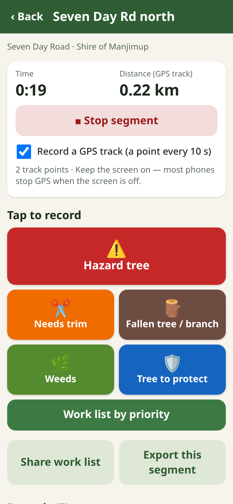
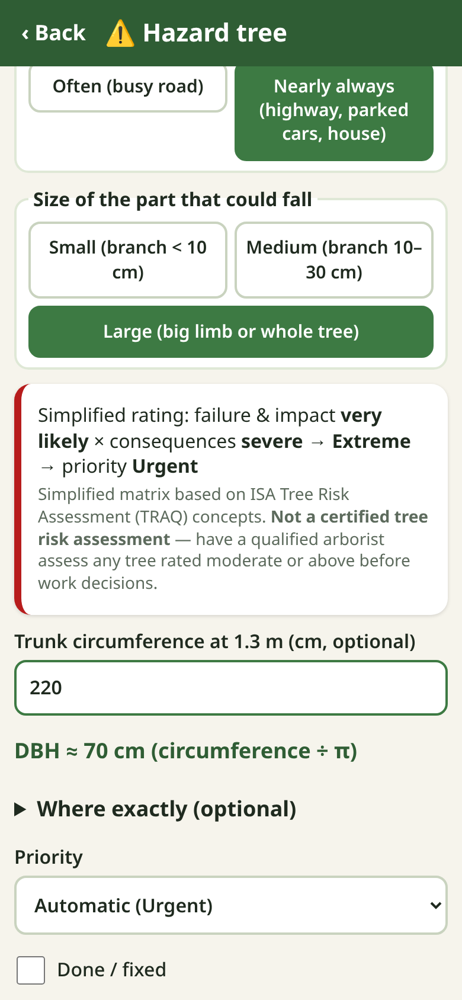

# Roadside Trees

A **free** phone app for shires and councils, utilities, contractors, landholders and volunteers to record **roadside and powerline vegetation**: trees needing a trim, hazard trees, fallen trees and branches, weeds, and significant / habitat trees to protect. You get a **work list sorted by priority** and a **CSV with lat/lon for GIS**.

Usable anywhere in the world (Western Australian contacts built in). Plain language, big buttons, cheap Android phones, **works offline after the first load**, no account, no server, no adverts. Data stays on your phone until you export it.

**Open the app:** https://johnrichardszpe-dot.github.io/roadside-trees/
(Then use the browser menu → *Add to Home screen* / *Install app*.)

By **John Richards**. Version 0.1.0.

 

> **Not a certified tree risk assessment and not legal advice.** The hazard rating is a simplified matrix based on ISA Tree Risk Assessment (TRAQ) concepts, for sorting field notes. Have a qualified arborist assess trees before work decisions. Who must act depends on the land manager and the law in your area.

## ⚠️ Safety
- **Driver drives.** A passenger uses the app, or stop somewhere safe well off the road. Don't stop on bends, crests, narrow or high-speed sections.
- Wear **high-vis**; follow your organisation's traffic-management rules; face traffic when walking.
- Don't climb, cut, push or stand under hazard trees. **Never approach power lines** — keep at least **8 m** from fallen lines and anything touching them; assume they are live.
- **Western Australia:** fallen / damaged / sparking lines or trees on lines — **Western Power 13 13 51** (24 h); regional Horizon Power **13 23 51**; life in danger **000**. Hazards on state roads — **Main Roads WA 138 138** (24/7). Local roads — your Shire or City. Elsewhere: your electricity network's emergency number, road authority and emergency number.
- Numbers verified in October 2026 from: [Western Power – damaged powerline](https://www.westernpower.com.au/safety/safety-at-home/make-the-safe-call/damaged-powerline/) and [reporting emergencies](https://www.westernpower.com.au/issues-enquiries/reporting-incidents-and-emergencies/) (13 13 51, keep 8 m away); [WA Government – report an electrical or gas incident](https://www.wa.gov.au/service/building-utilities-and-essential-services/energy-supply/report-electrical-or-gas-incident) (Western Power 13 13 51, Horizon Power 13 23 51); [Main Roads WA – contact](https://www.mainroads.wa.gov.au/contact-us/) (138 138, 24/7). Check they are still current.

## How to use
1. **New road segment** — road name, manager (e.g. Shire of Manjimup, Main Roads WA), how you travel, usual side (Left/Right as you face your direction of travel). Tap **Start segment**; a GPS track (a point every 10 s) is optional.
2. When you see something, tap a big button: **Hazard tree, Needs trim, Fallen tree/branch, Weeds, Tree to protect**. GPS (with accuracy) is taken automatically. Set side L/R, tick what you see; optionally add bearing (compass), distance to the tree, distance from road edge, and photos.
3. **Priority** is worked out with simple labelled rules (shown in the app) — you can override it. Mark items **Done** later.
4. **Stop segment → Work list by priority** — Urgent → High → Moderate → Low, then trees to protect, with approximate distance along the road.
5. **Export** — records CSV (WGS84 lat/lon), GeoJSON (QGIS/ArcGIS), work list text, JSON backup (restore on another phone). **Phone urgent hazards straight away — the app does not report anything.**

## Record types and priority rules
| Type | What you record | Automatic priority |
|---|---|---|
| Hazard tree | Visual indicators (dead tree, hanging/broken branch, large dead branches, lean, root-plate lift, cracks/splits, rot/cavity/fungi/termites, weak fork, fire damage); likelihood of failure (suggested from indicators, you decide); what it could hit; how often something is there; size of part; optional circumference → DBH | Simplified TRAQ-style matrix below (Extreme shown as **Urgent**) |
| Needs trim | Power line / over road / sight line / hides a sign / footpath; touching, inside clearance, or growing towards | Power line: touching = Urgent, inside = High, growing = Moderate. Others: touching = High, inside = Moderate, growing = Low |
| Fallen tree/branch | Blocking a lane, partly on road, or verge only; power lines involved | Lines involved or lane blocked = Urgent; partly on road = High; verge = Moderate |
| Weeds | Species, extent, length | Continuous = Moderate, otherwise Low |
| Tree to protect | Species, circumference → DBH (÷ π), reasons (hollows, large/old, habitat, rare, heritage) | "Protect (no work)" — flag before any clearing |

**Simplified hazard matrix** (ISA TRAQ concepts):
1. Likelihood of failure (improbable / possible / probable / imminent) × likelihood of impact (from how often something is there: rarely = very low, sometimes = low, often = medium, nearly always = high) → unlikely / somewhat likely / likely / very likely.
2. That result × consequences (simplified from part size: small < 10 cm = minor, medium 10–30 cm = significant, large limb or whole tree = severe) → **Low / Moderate / High / Extreme**.

Suggested likelihood of failure: no indicators = improbable; one minor indicator = possible; a strong indicator (hanging branch, root-plate lift, crack) or two indicators = probable; hanging branch + crack, root lift + lean, or two strong indicators = imminent. The user always decides.

## Methods and sources
- **Tree risk matrices:** ISA *Tree Risk Assessment* Best Management Practices and TRAQ (Smiley, Matheny & Lilly) — [ISA paper “Approaches to risk assessment”](https://wwv.isa-arbor.com/events/conference/proceedings/2013/SMILEY_MATHENY_Tree_Risk_Assessment_Qualitative_AN_Feb_2012.pdf); [S. Lilly, Tree Risk Assessment (2024)](https://www.greening.gov.hk/hk2024iufc/pdf/Sharon_Lilly.pdf) (matrices 1 and 2, occupancy → likelihood of impact).
- **Visual defects:** Mattheck & Breloer, *The Body Language of Trees* (Visual Tree Assessment) and the ISA defect categories.
- **WA vegetation near power lines:** WA Government [*Guidelines for the management of vegetation near power lines*](https://www.wa.gov.au/system/files/2024-10/guidelines_for_the_management_of_vegetation_near_power_lines.pdf) — planted/cultivated verge vegetation: local government or Main Roads WA; naturally occurring verge vegetation: the network operator; vegetation on private property: the owner/occupier. Western Power [keeping your vegetation clear](https://www.westernpower.com.au/safety/safety-at-home/make-the-safe-call/managing-trees-near-powerlines/keeping-your-vegetation-clear/).
- **WA roads:** Main Roads WA [Operational Procedure 112](https://www.mainroads.wa.gov.au/globalassets/technical-commercial/local-government-funding/operational-procedure-112-operational-boundaries-and-asset-responsibilities-metropolitan-region.pdf) (local governments control vegetation so signs and sight distance are not obscured on their roads); [Guideline for determination of sight distance for direction signs](https://www.mainroads.wa.gov.au/technical-commercial/technical-library/road-traffic-engineering/traffic-management/directional-sign-guidelines/guideline-for-determination-of-sight-distance-for-direction-signs/).
- **Clearing native vegetation (WA):** DWER [guide to the exemption for clearing for maintenance in existing transport corridors](https://www.wa.gov.au/system/files/2023-05/A-guide-to-the-exemption-for-clearing-native-vegetation-for-maintenance-in-existing-transport-corridors.pdf) — maintenance exemption only within limits and with the road manager's authority; widening/new works usually need a permit.

## CSV columns
`segment, road, authority, record_id, type, priority, risk_rating, done, date_local, side, chainage_m, latitude, longitude, accuracy_m, obs_latitude, obs_longitude, bearing_deg, distance_m, from_edge_m, species, dbh_cm, details, likelihood_failure, likelihood_impact, consequence, photos, notes`.
`latitude/longitude` (WGS84) are the tree's position: your GPS moved by distance + bearing when you give both, otherwise your GPS. `obs_*` is where you stood. `chainage_m` is the approximate distance along your GPS track from the segment start. All text starting with `= + - @` or a tab is prefixed with `'` so spreadsheets cannot run it as a formula.

## Honest limits
- Field notes and simple priorities — not ISA TRAQ, AS 4373 or any certified assessment; not legal advice about responsibility.
- Phone GPS is often ±5–15 m and worse in a moving car or under trees; chainage is approximate. Phone compasses are disturbed by vehicles — step away from the car for bearings.
- Track recording can stop if the screen turns off. Data lives only on this phone; clearing browser data deletes it — export backups. English only for now (`strings.js`).

## For developers
Plain HTML/CSS/JS, no build step. `node test.js` — every matrix cell, indicator suggestion, simple priority rules, DBH, offset point, chainage, work-list sort, CSV escaping / formula guard, GeoJSON. `browser-test.js` (puppeteer-core + Chrome) records a whole segment with photo, checks the work list, exports and an offline reload: `PUPPETEER=/path/to/puppeteer-core node browser-test.js http://localhost:8000/ shot.png`. When you change any file, bump `CACHE` in `sw.js`. `more-tools.js` is the shared “More free tools by John Richards” list.

## More free tools by John Richards
- 🌲 [Tree Gauge](https://johnrichardszpe-dot.github.io/tree-gauge/) — forest basal area with the phone camera (angle-gauge method)
- 🌱 [Planting Survey](https://johnrichardszpe-dot.github.io/planting-survey/) — seedling survival %, trees per hectare and photo points
- 🔥 [Fuel Check](https://johnrichardszpe-dot.github.io/fuel-check/) — simple step-by-step bushfire fuel hazard check
- 🧭 [Forest Explorer](https://johnrichardszpe-dot.github.io/forest-explorer/) — school forest science kit: height, trunk, carbon
- 🦜 [Habitat Survey](https://johnrichardszpe-dot.github.io/habitat-survey/) — habitat trees, hollows, wildlife sightings and signs
- 🍎 [Orchard Counter](https://johnrichardszpe-dot.github.io/orchard-counter/) — row-by-row tree counts, gaps, replant list, yield sample
- 🚧 [Roadside Trees](https://johnrichardszpe-dot.github.io/roadside-trees/) — roadside and powerline tree hazards, trimming and work lists *(this app)*
- 🌌 [Universe map](https://johnrichardszpe-dot.github.io/universe-map/) — explore John Richards' map of the universe

The same list is in the app (About / More tools screen), from the shared `more-tools.js`.

No licence has been chosen yet.
